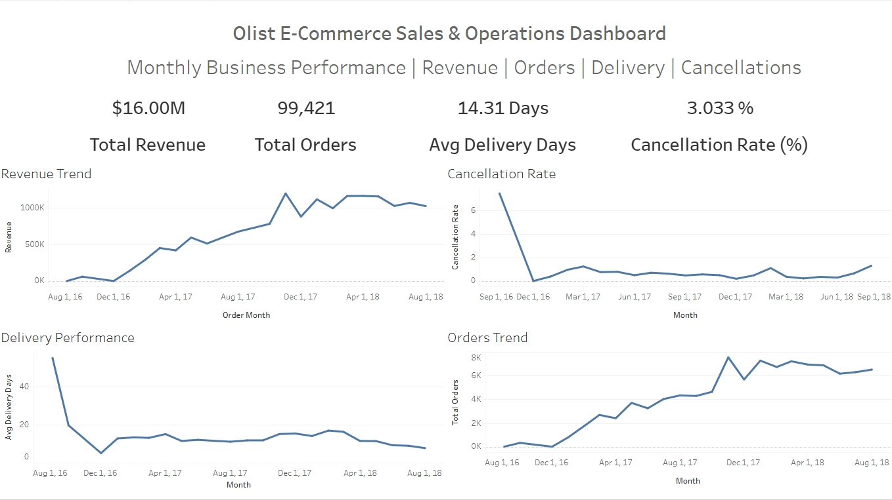
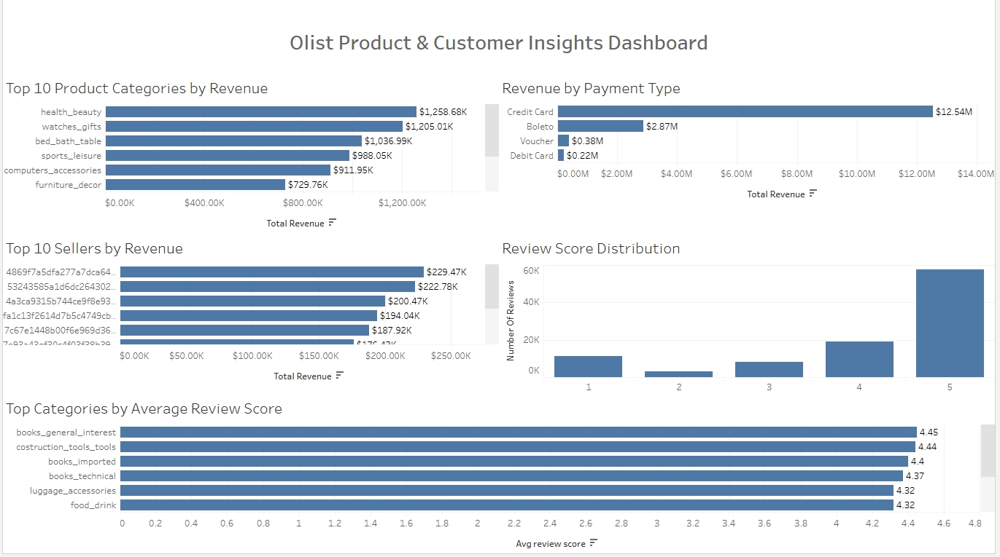

# Olist E-Commerce Data Analysis

End-to-end analytics project on the Brazilian Olist marketplace dataset using **Python, SQL (Google BigQuery) and Tableau Public**. It goes from raw data cleaning to executive dashboards, and ends with a statistical test of a business question: **do late deliveries hurt customer satisfaction?**

**[View the interactive Tableau dashboard](https://public.tableau.com/views/OlistExecutiveDashboard_17840465623420/OlistE-CommerceSalesOperationsDashboard?:language=en-US&:sid=&:redirect=auth&:display_count=n&:origin=viz_share_link)**



---

## Key Findings

| # | Finding | Evidence |
|---|---|---|
| 1 | **Late delivery is the biggest satisfaction risk.** Late orders are only 6.7% of reviewed orders but produce 32.5% of all 1-2 star reviews. | 62.4% of late orders get 1-2 stars vs 9.3% of on-time orders |
| 2 | **The effect is large and consistent.** Late orders average 2.27 stars vs 4.29 for on-time orders. | Mann-Whitney U p < 0.001, Cohen's d = 1.71, mean gap 2.02 stars (95% CI 1.98-2.06) |
| 3 | **Ratings fall steadily as delays grow.** Score drops from 4.32 (8+ days early) to 3.29 (1-3 days late), 2.11 (4-7 days late) and about 1.7 (8+ days late). | See dose-response table below |
| 4 | **Growth was strong, then plateaued.** Jan-Aug 2018 revenue was 141% higher than Jan-Aug 2017, but monthly orders stayed flat at roughly 6,000-7,000 through 2018 after the Nov 2017 spike (7,289 orders). | Monthly revenue and order trend |
| 5 | **Revenue depends on a small group of sellers.** The top 10% of sellers (297 of 2,970) generate 67.1% of revenue; the top 20% generate 82.3%. | Seller revenue ranking |
| 6 | **Credit card dominates payments.** 78.5% of payment value, followed by boleto at 18.0%. | Payment value by type |
| 7 | **Health & beauty, watches & gifts and bed & bath lead revenue.** 9.3%, 8.8% and 7.7% of total revenue respectively. | Revenue by product category |
| 8 | **Operations look healthy overall.** Cancellation rate is 0.63% (625 of 99,441 orders); average delivery takes 12.5 days against an average promised 24.4 days. | Order status and delivery timestamps |

### Dose-response: review score by delivery timing

| Delivery timing | Orders | Mean score | 1-2 star share |
|---|---|---|---|
| 8+ days early | 70,929 | 4.32 | 9.0% |
| 1-7 days early | 17,234 | 4.20 | 10.2% |
| On estimate day | 1,280 | 4.03 | 12.4% |
| 1-3 days late | 1,852 | 3.29 | 32.1% |
| 4-7 days late | 1,748 | 2.11 | 67.6% |
| 8-14 days late | 1,446 | 1.67 | 80.2% |
| 15+ days late | 1,335 | 1.72 | 78.4% |

### Business recommendations
- **Prioritise on-time reliability over speed.** Customers are far more sensitive to missing the promised date than to how long delivery takes overall. Satisfaction collapses within the first week of delay.
- **Flag at-risk orders early** (for example orders approaching the estimated date) so support can reach out before a bad review is written.
- **Monitor late rates by seller and state** and focus carrier or seller interventions where lateness is concentrated.
- **Reduce seller concentration risk** by developing mid-tier sellers, since a few sellers drive most revenue.

---

## Analytical Question and Hypothesis Test

**Question:** Does delivering after the estimated date reduce customer review scores, and does the effect survive controlling for location and product category?

- **H0:** review scores are the same for late and on-time deliveries.
- **H1:** late deliveries receive lower review scores.

**Method**
- Sample: 95,824 delivered orders with one review each.
- Late = delivered after the estimated delivery date.
- Review scores are ordinal and skewed, so the primary test is **Mann-Whitney U**; Welch's t-test, Cohen's d and a chi-square on the 1-2 star share are secondary checks.
- **Confounder checks:** late vs on-time compared within each customer state and product category, plus a regression with state and category fixed effects.

**Results**
- The gap is positive in 26 of 27 states and all 29 product categories with 30+ late orders. The only exception is AP, which has just 2 late orders.
- The late-weighted gap is 2.00 stars within states and 2.02 within categories, essentially identical to the raw 2.02 gap, so location and category do not explain the effect.

**Limitations**
- This is observational data, so it shows a strong association rather than proven causation. Unmeasured factors such as seller quality, delivery distance and product condition could contribute.
- Only customers who left a review are included.
- Review score is ordinal, so the 1-2 star share is the more interpretable business metric.

Full code: [`olist_late_delivery_hypothesis_test.ipynb`](olist_late_delivery_hypothesis_test.ipynb)

---

## Business Objectives

- Track monthly revenue and order trends
- Measure cancellation rate and delivery performance
- Identify top product categories, payment methods and sellers
- Measure customer satisfaction and what drives it

## Dashboards

**Dashboard 1 - Executive Overview:** monthly revenue, total orders, cancellation rate, average delivery days.

**Dashboard 2 - Product & Customer Insights:** top categories by revenue, revenue by payment type, top sellers, review score distribution, categories by average review score.



---

## Methodology and Data Cleaning

1. **Cleaning (Python / pandas):** documented in [`Olist_Data_Cleaning.ipynb`](Olist_Data_Cleaning.ipynb). Cleaned tables were loaded into BigQuery as `cleaned_*` tables.
2. **Key cleaning decisions**
   - `review_score` is stored as text, so it is cast to an integer before analysis.
   - Some orders have more than one review; the latest review per order is kept to avoid double counting.
   - Delivery metrics use only delivered orders with a delivery timestamp.
3. **Analysis (BigQuery SQL):** dashboard queries and advanced queries (joins, CTEs, window functions) are in [`Dashboard_1_Queries.sql`](Dashboard_1_Queries.sql), [`Dashboard_2_Queries.sql`](Dashboard_2_Queries.sql) and [`Advanced_SQL_Queries_by me.sql`](Advanced_SQL_Queries_by%20me.sql).
4. **Visualisation:** Tableau Public dashboards built on the BigQuery output.

**Metric definitions**
- *Revenue* = sum of item price on delivered orders (excludes freight).
- *Payment value* (used only for payment-type shares) = sum of `payment_value`, which includes freight.
- *Cancellation rate* = canceled orders / all orders.
- *Late order* = delivery date after the estimated delivery date.

## AI-Assisted BigQuery Workflow

A Python FastMCP server connects Claude Desktop to the BigQuery dataset for schema inspection, column profiling and natural-language SQL querying. Every query is parsed with sqlglot: only single read-only SELECT statements inside the Olist dataset are allowed, results are capped at 100 rows, and queries scanning more than 100 MiB are blocked by a BigQuery dry run and a hard billing ceiling.

Details and setup: [`mcp_server/`](mcp_server/README.md)

---

## Repository Structure

```
Olist_Data_Cleaning.ipynb                   data cleaning (Python / pandas)
olist_late_delivery_hypothesis_test.ipynb   late delivery hypothesis test
Dashboard_1_Queries.sql                     SQL for Dashboard 1
Dashboard_2_Queries.sql                     SQL for Dashboard 2
Advanced_SQL_Queries_by me.sql              advanced SQL (joins, CTEs, window functions)
Dashboard_1.jpeg, Dashboard_2.jpeg          dashboard screenshots
mcp_server/                                 FastMCP server with SQL guardrails (see its README)
README.md
```

## Dataset

[Brazilian E-Commerce Public Dataset by Olist](https://www.kaggle.com/datasets/olistbr/brazilian-ecommerce) (Kaggle): about 100K orders from 2016 to 2018 covering customers, orders, items, payments, reviews, products, sellers and geolocation. The raw data is not stored in this repository.

## How to Reproduce

1. Download the dataset from Kaggle and run `Olist_Data_Cleaning.ipynb` to produce the cleaned tables.
2. Load the cleaned tables into a BigQuery dataset.
3. Run `Dashboard_1_Queries.sql` and `Dashboard_2_Queries.sql` to rebuild the dashboard data sources.
4. Run `olist_late_delivery_hypothesis_test.ipynb` (set your BigQuery project and dataset names in the first cell). Requires `google-cloud-bigquery`, `pandas`, `scipy` and `statsmodels`.

## Tools

Python (pandas, NumPy, SciPy, statsmodels) | Google BigQuery (SQL) | Tableau Public | GitHub

## Author

**Manjunatha R J**, Data Analyst
Skills: SQL, Python, Google BigQuery, Tableau, Excel, statistics
